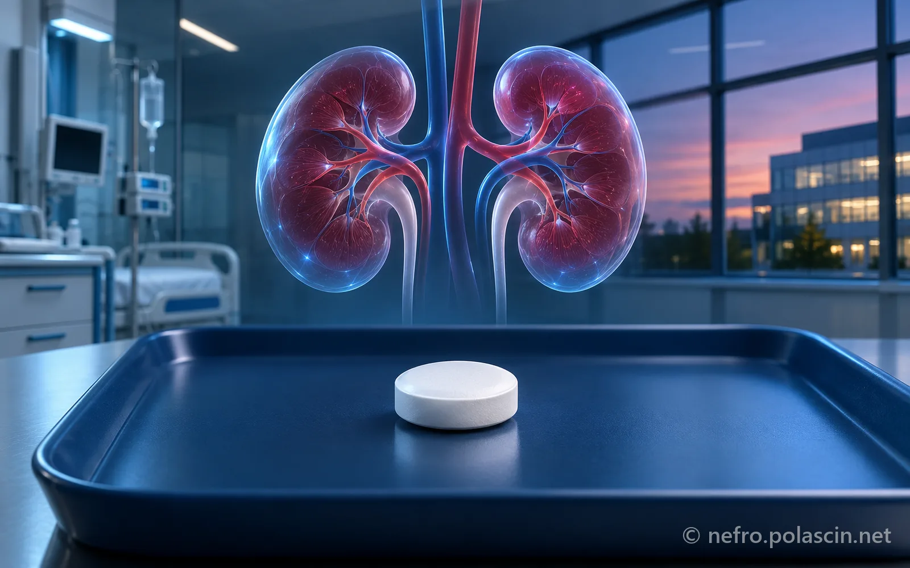

# Ibuprofén a akútne poškodenie obličiek u hospitalizovaných dospelých

U hospitalizovaných dospelých liečených pre akútnu bolesť bol ibuprofén po zohľadnení východiskových rozdielov medzi skupinami spojený s vyššou incidenciou akútneho poškodenia obličiek (AKI) ako oxykodón. Súvislosť bola výraznejšia u kriticky chorých a u pacientov po operácii. U mladších pacientov s nízkym rizikom dodatočná analýza zvýšenie incidencie nezachytila. Interval spoľahlivosti však pripúšťa aj jej mierne zvýšenie. [1]

## Ako štúdia porovnávala analgetiká

Thelenová a spoluautori analyzovali údaje z troch nemocníc vo Filadelfii od januára 2004 do júna 2017. Do retrospektívnej kohorty zaradili 78 656 dospelých, ktorí dostávali analgetikum aspoň 24 hodín. Ibuprofén dostávalo 6 313 pacientov a oxykodón 72 343. Z analýzy vylúčili okrem iného pacientov s prebiehajúcim AKI, po transplantácii solídneho orgánu a pacientov bez merania sérového kreatinínu pred začatím liečby alebo počas sledovania. Medián sledovania bol tri dni. [1]

Oxykodón slúžil ako aktívna porovnávacia liečba, pretože aj ním sa lieči akútna bolesť v nemocnici. Pacienti, ktorí dostávali ibuprofén, mali nižší medián veku (52 oproti 59 rokom), vyššiu východiskovú odhadovanú glomerulovú filtráciu (eGFR) a menej často boli po operácii alebo na jednotke intenzívnej starostlivosti. Autori preto priradili pacientom v skupine s oxykodónom štatistické váhy tak, aby sa rozdelenie meraných východiskových charakteristík priblížilo skupine liečenej ibuprofénom. Odhad sa tak vzťahuje predovšetkým na populáciu podobnú pacientom, ktorým lekári v tejto kohorte predpísali ibuprofén. [1]

AKI sa určovalo podľa zmien sérového kreatinínu a začatia liečby nahrádzajúcej funkciu obličiek. Autori vychádzali z kritérií KDIGO a pri hodnotení nepoužili diurézu. Za závažné považovali AKI v štádiu 2 alebo 3. [1]

## Čo ukázalo porovnanie

Počas sledovania zaznamenali 4 799 prípadov AKI, z toho 79 % v štádiu 1. Hrubá incidencia AKI bola 16,4 pri ibuproféne a 17,8 pri oxykodóne na 1 000 dní sledovania. Po vážení sa smer porovnania obrátil. Upravený pomer incidencií (IRR) bol 1,22 pre AKI ktoréhokoľvek štádia (95 % interval spoľahlivosti od 1,09 do 1,38) a 1,36 pre AKI v štádiu 2 alebo 3 (od 1,08 do 1,72). Ide o pomery incidencií na jednotku času. [1]

Dialýza sa začala u siedmich pacientov v skupine s ibuprofénom a u 57 v skupine s oxykodónom. Upravený IRR bol 3,29, so širokým 95 % intervalom spoľahlivosti od 1,35 do 8,03. Pri predĺženom sledovaní bol odhad nižší, 2,02, a interval od 0,87 do 4,67 zahŕňal hodnotu 1. Výsledok pri dialýze preto upozorňuje na možné závažné následky, no veľkosť rozdielu zostáva neistá. [1]

## Kde bola súvislosť výraznejšia

U kriticky chorých bol IRR pre AKI 1,65 (95 % interval spoľahlivosti od 1,29 do 2,11), u ostatných 1,16 (od 1,02 do 1,33). Po operácii bol IRR 1,70 (od 1,28 do 2,27) a mimo pooperačného obdobia 1,12 (od 0,98 do 1,28). Aj mimo intenzívnej starostlivosti teda bola pri ibuproféne incidencia AKI mierne vyššia po zohľadnení východiskových rozdielov. [1]

Do dodatočne vymedzenej skupiny s nízkym rizikom patrili pacienti mladší ako 60 rokov s eGFR vyššou ako 60 ml/min/1,73 m², ktorí neboli kriticky chorí ani po operácii. V tejto skupine bol IRR 0,94 (95 % interval spoľahlivosti od 0,75 do 1,18). Testy interakcie s vekom a eGFR ako spojitými premennými neboli štatisticky významné. Hranice použité na vymedzenie podskupiny preto nemožno považovať za overené prahy bezpečného podávania. Samotná hodnota eGFR navyše nevylučuje chronickú chorobu obličiek. [1, 5]

## Ako výsledok zapadá do ďalších údajov

Jeonová a spoluautori pri retrospektívnej analýze 18 794 hospitalizácií zistili súvislosť medzi podávaním nesteroidových protizápalových liekov (NSAID) a AKI u pacientov s už prítomnou poruchou funkcie obličiek (upravený pomer hazardov 1,38, 95 % interval spoľahlivosti od 1,04 do 1,83). U pacientov so zachovanou funkciou obličiek bolo interval spoľahlivosti zlučiteľný aj s nulovým rozdielom (0,83, od 0,63 do 1,08). V kohorte z Mayo Clinic bolo porovnanie pacientov liečených systémovými NSAID s pacientmi bez tejto liečby nepresné (pomer šancí 0,82, 95 % interval spoľahlivosti od 0,27 do 1,85). Obe štúdie používali odlišné porovnávacie skupiny a skúmali NSAID ako skupinu liekov. [2, 3]

Z nefrologického hľadiska je pozorovanie u pacientov po operácii a pri kritickom ochorení biologicky prijateľné. Pri zníženej perfúzii obličiek pomáhajú prostaglandíny udržiavať prietok krvi v obličkách a glomerulovú filtráciu. Inhibícia ich tvorby môže túto kompenzáciu oslabiť. Samostatná britská štúdia u pacientov liečených antihypertenzívami zistila vyššiu incidenciu AKI pri súbehu NSAID, diuretika a inhibítora angiotenzín konvertujúceho enzýmu alebo sartanu. Najvyšší odhad zaznamenala počas prvých 30 dní kombinovanej liečby. [4, 5]

## Čo z toho vyplýva pre nemocničnú prax

Pri výbere analgetika je dôležitý aktuálny stav pacienta. Po operácii alebo počas kritického ochorenia sa môže perfúzia obličiek zhoršiť aj u človeka s priaznivou východiskovou eGFR. Pri zvažovaní NSAID preto treba posúdiť vývoj kreatinínu, hemodynamiku, stav hydratácie a súbežnú liečbu. KDIGO pri chronickej chorobe obličiek odporúča uprednostniť vhodnú menej nefrotoxickú alternatívu, ak je dostupná, a pri použití potenciálne nefrotoxického lieku zvážiť očakávaný prínos, riziko a potrebné sledovanie. [5]

V kohorte chýbali údaje o hypotenzii, hypovolémii a sepse. Ani dôsledné vyváženie meraných premenných preto nevylučuje skreslenie pri výbere analgetika. Údaje pochádzajú z jedného nemocničného systému a môžu len sčasti odrážať dnešnú prax pri výbere analgetík. Štúdia hodnotila výsledky týkajúce sa obličiek. Porovnanie účinnosti analgézie, krvácania či nežiaducich účinkov opioidov by si vyžadovalo ďalšie údaje. [1]

## Zdroje

1. *Haedi E. Thelen, Luke J. Keele, Christina Brotman, Michael G. S. Shashaty, Todd A. Miano. Ibuprofen Use and Acute Kidney Injury Among Adults Admitted to the Hospital. JAMA Network Open. 2026;9(11):e2642745.* [Vydavateľ a prílohy](https://jamanetwork.com/journals/jamanetworkopen/fullarticle/2856366) · [DOI](https://doi.org/10.1001/jamanetworkopen.2026.42745) · [PubMed](https://pubmed.ncbi.nlm.nih.gov/43007674/)
2. *Nakyung Jeon, Haesuk Park, Richard Segal, Babette Brumback, Almut G. Winterstein. Non-steroidal anti-inflammatory drug-associated acute kidney injury: does short-term NSAID use pose a risk in hospitalized patients? European Journal of Clinical Pharmacology. 2021;77(9):1409-1417.* [Vydavateľ a DOI](https://doi.org/10.1007/s00228-021-03121-0) · [PubMed](https://pubmed.ncbi.nlm.nih.gov/33772627/)
3. *Katie M. Rieck, Darrell R. Schroeder, Michael A. Mao. Inpatient NSAID Exposure and Development of Acute Kidney Injury in Medical Inpatients: A Retrospective Cohort Study. American Journal of Medicine Open. 2026;15:100119.* [Vydavateľ a DOI](https://doi.org/10.1016/j.ajmo.2025.100119) · [PubMed](https://pubmed.ncbi.nlm.nih.gov/41488217/) · [Plný text](https://pmc.ncbi.nlm.nih.gov/articles/PMC12757445/)
4. *Francesco Lapi, Laurent Azoulay, Hui Yin, Sharon J. Nessim, Samy Suissa. Concurrent use of diuretics, angiotensin converting enzyme inhibitors, and angiotensin receptor blockers with non-steroidal anti-inflammatory drugs and risk of acute kidney injury: nested case-control study. BMJ. 2013;346:e8525.* [Vydavateľ a DOI](https://doi.org/10.1136/bmj.e8525) · [PubMed](https://pubmed.ncbi.nlm.nih.gov/23299844/) · [Plný text](https://pmc.ncbi.nlm.nih.gov/articles/PMC3541472/)
5. *Kidney Disease: Improving Global Outcomes (KDIGO) CKD Work Group. KDIGO 2024 Clinical Practice Guideline for the Evaluation and Management of Chronic Kidney Disease. Kidney International. 2024;105(4S):S117-S314.* [Odporúčanie KDIGO](https://kdigo.org/wp-content/uploads/2024/03/KDIGO-2024-CKD-Guideline.pdf) · [Vydavateľ a DOI](https://doi.org/10.1016/j.kint.2023.10.018) · [PubMed](https://pubmed.ncbi.nlm.nih.gov/38490803/)

*Východisková správa: Kristen Monaco. Ibuprofen and Kidney Injury: Study Reveals Who Is Most at Risk. MedPage Today, 11. novembra 2026.* [MedPage Today](https://www.medpagetoday.com/nephrology/generalnephrology/123842)
