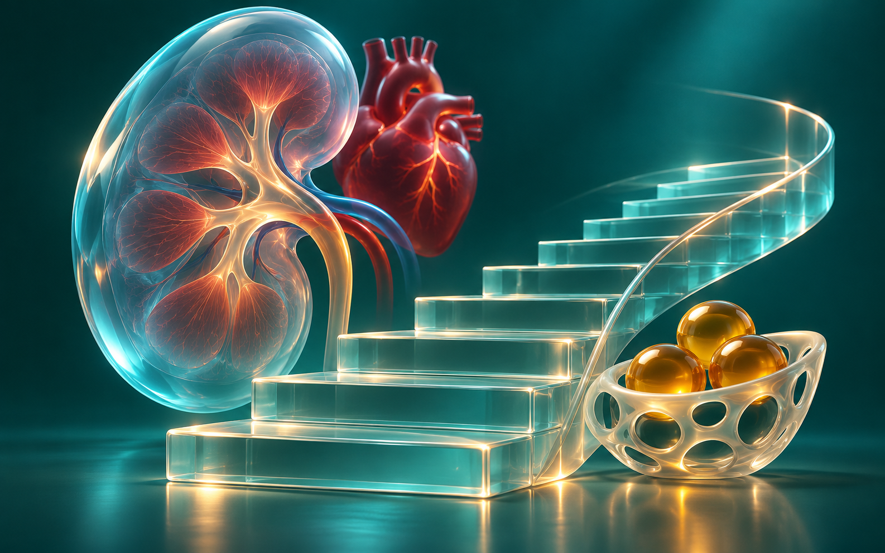
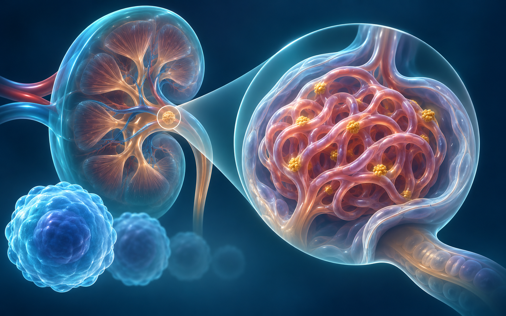
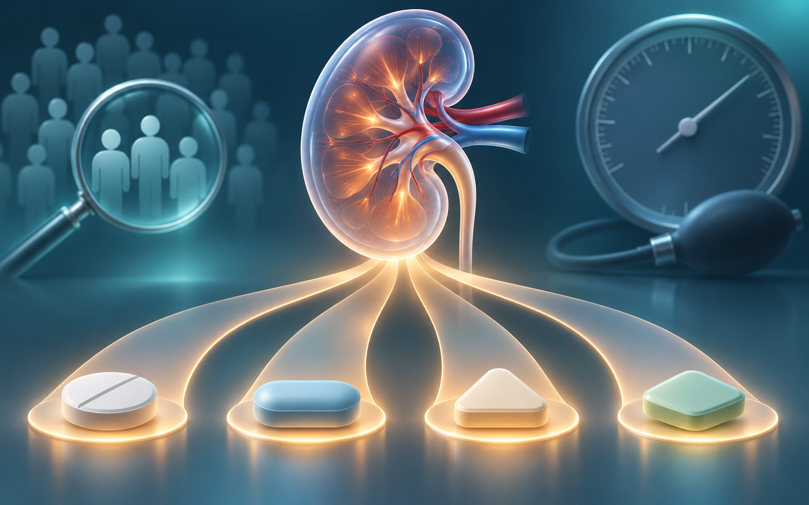

# Nefro: slovenské a anglické anotácie

17. 11. 2026. Päť odborných článkov, dvadsať zverejnených dvojjazyčných príspevkov.

## Finerenón pri FSGS: pomalší pokles filtrácie v podskupine FIND-CKD

Finerenón pri FSGS spomalil pokles eGFR a znížil proteinúriu. Prínos pre riziko zlyhania obličiek zostáva neistý.

Finerenone slowed eGFR decline and reduced proteinuria in FSGS. Benefit for kidney failure risk remains uncertain.

https://nefro.polascin.net/article.php?slug=finerenon-fsgs-find-ckd-podskupina

x: https://x.com/polascin/status/2122707184668570020

facebook: https://www.facebook.com/photo/?fbid=10245842747302424

linkedin: https://www.linkedin.com/feed/update/urn:li:activity:7528474337838854144/

threads: https://www.threads.com/@lubomirpolascin/post/Df2NM3EiMSJ

Google Disk: https://drive.google.com/file/d/14S87cW734VmvQlW2MQJss7atrvR4cJN5/view

*Hiddo J L Heerspink, Brendon L Neuen, Rajiv Agarwal, David Z I Cherney, Carolyn S P Lam, Katherine R Tuttle, Christoph Wanner, Pantelis Sarafidis, Glenn M Chertow, Tim Friede, Jonathan Barratt, Jürgen Floege, Alfredo Chew-Wong, Vladimir Dobronravov, Susanne B Nicholas, Hirokazu Okada, David Packham, Pablo E Pergola, Marijn M Speeckaert, Shuifu Tang, Niels Jongs, J David Smeijer, Carolina Aldworth, Mario Berger, Meike Brinker, Rania Dayoub, Marina Yael Finkelsztein, Aidan MacNamara, Patrick Schloemer, Vlado Perkovic, FIND-CKD Investigators. Finerenone in Patients with Focal Segmental Glomerulosclerosis. J Am Soc Nephrol. 2026. Elektronická publikácia pred zaradením do čísla. DOI 10.1681/ASN.0000001333 (https://doi.org/10.1681/ASN.0000001333) · PubMed 43034991 (https://pubmed.ncbi.nlm.nih.gov/43034991/)*

*Hiddo J L Heerspink, Brendon L Neuen, Rajiv Agarwal, David Z I Cherney, Carolyn S P Lam, Katherine R Tuttle, Christoph Wanner, Pantelis Sarafidis, Niels Jongs, J David Smeijer, Meike Brinker, Nicole Rethemeier, Patrick Schloemer, Paula Vesterinen, David Goldsbury, Sara Dizayee, Jon W Mares, Vlado Perkovic, FIND-CKD Investigators. Finerenone in Persons with Chronic Kidney Disease without Diabetes. N Engl J Med. 2026;395(6):533 až 545. DOI 10.1056/NEJMoa2604625 (https://doi.org/10.1056/NEJMoa2604625) · PubMed 42246672 (https://pubmed.ncbi.nlm.nih.gov/42246672/)*

*European Medicines Agency. Kerendia: Summary of product characteristics, oddiely 4.1, 4.2 a 4.4. Znenie dostupné pri kontrole 17. 11. 2026. Oficiálny súhrn charakteristických vlastností lieku (https://www.ema.europa.eu/en/documents/product-information/kerendia-epar-product-information_en.pdf).*

## ISCHEMIA-CKD po ôsmich rokoch: úvodná invazívna stratégia nepreukázala prínos pre prežívanie

ISCHEMIA-CKD: ani po ôsmich rokoch sa nepreukázal prínos úvodnej invazívnej stratégie pre prežívanie pri stabilnej koronárnej chorobe a pokročilej CKD.

No proven survival benefit at eight years from an initial invasive strategy in stable coronary disease and advanced CKD.

https://nefro.polascin.net/article.php?slug=ischemia-ckd-extend-osemrocne-prezivanie

x: https://x.com/polascin/status/2122709814895853924

facebook: https://www.facebook.com/photo/?fbid=10245842771543030

linkedin: https://www.linkedin.com/feed/update/urn:li:activity:7528474991143759872/

threads: https://www.threads.com/@lubomirpolascin/post/Df2OP6ZCEwf

Google Disk: https://drive.google.com/file/d/1QNWe1VsCpJ5w90bKL2NVEgjKVXSTtnVF/view

*Sripal Bangalore, David J Maron, Rebecca Anthopolos, Harmony R Reynolds, Yifan Xu, Michelle Chang, Stephanie Boumakis, Jose Lopez-Sendon, Roxy Senior, Shaun G Goodman, Sean M O'Brien, Jerome L Fleg, Judith S Hochman, ISCHEMIA-CKD EXTEND Research Group. Long-Term Survival After Initial Invasive or Conservative Management of Stable Coronary Disease in Patients With Advanced Chronic Kidney Disease: ISCHEMIA-CKD EXTEND. Circulation. 2026. Elektronická publikácia pred zaradením do čísla. DOI 10.1161/CIRCULATIONAHA.126.083858 (https://doi.org/10.1161/CIRCULATIONAHA.126.083858) · PubMed 42998238 (https://pubmed.ncbi.nlm.nih.gov/42998238/)*

*Sripal Bangalore, David J Maron, Sean M O'Brien, Jerome L Fleg, Evgeny I Kretov, Carlo Briguori, Upendra Kaul, Harmony R Reynolds, Tomasz Mazurek, Mandeep S Sidhu, Jeffrey S Berger, Roy O Mathew, Olga Bockeria, Samuel Broderick, Radoslaw Pracon, Charles A Herzog, Zhen Huang, Gregg W Stone, William E Boden, Jonathan D Newman, Ziad A Ali, Daniel B Mark, John A Spertus, Karen P Alexander, Bernard R Chaitman, Glenn M Chertow, Judith S Hochman, ISCHEMIA-CKD Research Group. Management of Coronary Disease in Patients with Advanced Kidney Disease. N Engl J Med. 2020;382(17):1608 až 1618. DOI 10.1056/NEJMoa1915925 (https://doi.org/10.1056/NEJMoa1915925) · PubMed 32227756 (https://pubmed.ncbi.nlm.nih.gov/32227756/)*

*Charles A Herzog, Mengistu A Simegn, Yifan Xu, Salvatore P Costa, Roy O Mathew, Mohammad C El-Hajjar, Sanjeev Gulati, Rafael A Maldonado, Eric Daugas, Magdelena Madero, Jerome L Fleg, Rebecca Anthopolos, Gregg W Stone, Mandeep S Sidhu, David J Maron, Judith S Hochman, Sripal Bangalore. Kidney Transplant List Status and Outcomes in the ISCHEMIA-CKD Trial. J Am Coll Cardiol. 2021;78(4):348 až 361. DOI 10.1016/j.jacc.2021.05.001 (https://doi.org/10.1016/j.jacc.2021.05.001) · PubMed 33989711 (https://pubmed.ncbi.nlm.nih.gov/33989711/)*

## Cyklosilikát sodno-zirkoničitý pri CKD a HFrEF: podpora titrácie liečby v štúdii LIFT

LIFT: SZC uľahčil titráciu liečby pri CKD a HFrEF. Potrebné boli časté kontroly. Dlhodobý klinický prínos zostáva nepreukázaný.

SZC enabled medication titration in CKD and HFrEF with close monitoring. Long-term clinical benefit remains unproven.

https://nefro.polascin.net/article.php?slug=szc-titracia-raasi-ckd-hfref-lift

x: https://x.com/polascin/status/2122710228508581999

facebook: https://www.facebook.com/photo/?fbid=10245842797983691

linkedin: https://www.linkedin.com/feed/update/urn:li:activity:7528475735842451456/

threads: https://www.threads.com/@lubomirpolascin/post/Df2ObFxiFt8

Google Disk: https://drive.google.com/file/d/1QuuoyHAtXLlZb_0gosnCJHSv6K23r57F/view

*Debasish Banerjee, Mahrukh Ali, Ella Tumelty, Daniel Murphy, Hilary Warrens, Simran Parmar, Thomas McNally, Tony Lopez, Sharirose Abat, Riny Paul, Sabba Hussain, Souradip Mookerjee, Isaac Chung, Irina Chis Ster, Lisa Anderson. Rapid Renin Angiotensin Aldosterone System inhibitor optimisation in patients with chronic kidney disease and heart failure with reduced ejection fraction using potassium binder: a randomised, double-blinded, placebo-controlled trial. Nat Commun. 2026;17(1):11614. DOI 10.1038/s41467-026-78377-0 (https://doi.org/10.1038/s41467-026-78377-0) · PubMed 43015282 (https://pubmed.ncbi.nlm.nih.gov/43015282/)*

*Daniel Murphy, Irina Chis Ster, Juan-Carlos Kaski, Lisa Anderson, Debasish Banerjee. The LIFT trial: study protocol for a double-blind, randomised, placebo-controlled trial of K+-binder Lokelma for maximisation of RAAS inhibition in CKD patients with heart failure. BMC Nephrol. 2021;22(1):254. DOI 10.1186/s12882-021-02439-2 (https://doi.org/10.1186/s12882-021-02439-2) · PubMed 34229607 (https://pubmed.ncbi.nlm.nih.gov/34229607/)*

*Mikhail N Kosiborod, David Z I Cherney, Akshay S Desai, Jeffrey M Testani, Subodh Verma, Khaja Chinnakondepalli, David Dolling, Shachi Patel, Magnus Dahl, James M Eudicone, Lovisa Friberg, Mario Ouwens, Murillo O Antunes, Kim A Connelly, Vagner Madrini, Luca Kuthi, Anuradha Lala, Miguel Lorenzo, Patrícia O Guimarães, Marta Cobo Marcos, Béla Merkely, Julio Nuñez, Iain Squire, Jan Václavík, Jerzy Wranicz, Mark C Petrie. Sodium Zirconium Cyclosilicate for Management of Hyperkalemia During Spironolactone Optimization in Patients With Heart Failure. J Am Coll Cardiol. 2025;85(10):971 až 984. DOI 10.1016/j.jacc.2024.11.014 (https://doi.org/10.1016/j.jacc.2024.11.014) · PubMed 39566872 (https://pubmed.ncbi.nlm.nih.gov/39566872/)*

*European Medicines Agency. Lokelma: Summary of product characteristics, oddiely 2, 4.4 a 4.8. Znenie dostupné pri kontrole 17. 11. 2026. Oficiálny súhrn charakteristických vlastností lieku (https://www.ema.europa.eu/en/documents/product-information/lokelma-epar-product-information_en.pdf).*

## Rituximab pri IgA nefropatii: štúdia RITA nepotvrdila prínos k podpornej liečbe

RITA: rituximab pri IgA nefropatii nepreukázal dodatočný prínos pre proteinúriu ani eGFR.

Rituximab showed no added benefit for proteinuria or eGFR in IgA nephropathy.

https://nefro.polascin.net/article.php?slug=rituximab-iga-nefropatia-rita

x: https://x.com/polascin/status/2122710677689078222

facebook: https://www.facebook.com/photo/?fbid=10245842833264573

linkedin: https://www.linkedin.com/feed/update/urn:li:activity:7528476214542651392/

threads: https://www.threads.com/@lubomirpolascin/post/Df2OrUNiFSY

Google Disk: https://drive.google.com/file/d/1I6wiJvuUXwUA2dJmuttEnMdxRNkwV96z/view

*Yan Ouyang, Hong Ren, Weiming Wang, Na Liu, Beiyan Bao, Hua Li, Xiaoling Xiong, Jian Li, Duolao Wang, Qinjie Weng, Chaohui Wang, Jingyuan Xie, Nan Chen. Rituximab in IgA Nephropathy: The RITA Multicenter Randomized Trial. Am J Kidney Dis. 2026. Elektronická publikácia pred zaradením do čísla. DOI 10.1053/j.ajkd.2026.07.017 (https://doi.org/10.1053/j.ajkd.2026.07.017) · PubMed 42998785 (https://pubmed.ncbi.nlm.nih.gov/42998785/)*

*Richard A Lafayette, Pietro A Canetta, Brad H Rovin, Gerald B Appel, Jan Novak, Karl A Nath, Sanjeev Sethi, James A Tumlin, Kshama Mehta, Marie Hogan, Stephen Erickson, Bruce A Julian, Nelson Leung, Felicity T Enders, Rhubell Brown, Barbora Knoppova, Stacy Hall, Fernando C Fervenza. A Randomized, Controlled Trial of Rituximab in IgA Nephropathy with Proteinuria and Renal Dysfunction. J Am Soc Nephrol. 2017;28(4):1306 až 1313. DOI 10.1681/ASN.2016060640 (https://doi.org/10.1681/ASN.2016060640) · PubMed 27821627 (https://pubmed.ncbi.nlm.nih.gov/27821627/)*

*Gian Marco Berti, Francesco Tondolo, Anna Iandolo, Gisella Vischini, Daniele Vetrano, Edoardo Tringali, Olga Baraldi, Benedetta Fabbrizio, Stefano Chillotti, Gianandrea Pasquinelli, Gaetano La Manna, Federica Maritati. Rituximab-Based Therapy in IgA Nephropathy With Crescents: A Comparative Study. Clin Ther. 2026. Elektronická publikácia pred zaradením do čísla. DOI 10.1016/j.clinthera.2026.08.009 (https://doi.org/10.1016/j.clinthera.2026.08.009) · PubMed 42697788 (https://pubmed.ncbi.nlm.nih.gov/42697788/)*

## Druhé antihypertenzívum pri CKD: priaznivá asociácia tiazidov nie je univerzálnym poradím liekov

Druhé antihypertenzívum pri CKD: priaznivá asociácia tiazidov nie je dôkaz nadradenosti. Rozhoduje aj klinická indikácia.

Second-line BP treatment in CKD: favourable thiazide associations do not prove superiority. Clinical indication matters.

https://nefro.polascin.net/article.php?slug=druhe-antihypertenzivum-ckd-tiazid-observacna-studia

x: https://x.com/polascin/status/2122711080480948259

facebook: https://www.facebook.com/photo/?fbid=10245842849544980

linkedin: https://www.linkedin.com/feed/update/urn:li:activity:7528476793310355456/

threads: https://www.threads.com/@lubomirpolascin/post/Df2O2BmiPCw

Google Disk: https://drive.google.com/file/d/1DCNio4zVIUDNqprXNK39XiSSDqOqLaBM/view

*L Parker Gregg, Aaron Perkins, Hui Yang, Christine Vu, Vijay Nambi, Wolfgang C Winkelmayer, S Susan Hedayati, Sankar D Navaneethan, Carlos A Alvarez. Association of Second Anti-hypertensive Agent with Outcomes in People with CKD on ACEi/ARB Therapy. J Am Soc Nephrol. 2026. Elektronická publikácia pred zaradením do čísla. DOI 10.1681/ASN.0000001313 (https://doi.org/10.1681/ASN.0000001313) · PubMed 43024400 (https://pubmed.ncbi.nlm.nih.gov/43024400/)*

*Rajiv Agarwal, Arjun D Sinha, Andrew E Cramer, Mary Balmes-Fenwick, Jazmyn H Dickinson, Fangqian Ouyang, Wanzhu Tu. Chlorthalidone for Hypertension in Advanced Chronic Kidney Disease. N Engl J Med. 2021;385(27):2507 až 2519. DOI 10.1056/NEJMoa2110730 (https://doi.org/10.1056/NEJMoa2110730) · PubMed 34739197 (https://pubmed.ncbi.nlm.nih.gov/34739197/)*

*Panagiotis I Georgianos, Rajiv Agarwal. Hypertension in chronic kidney disease-treatment standard 2023. Nephrol Dial Transplant. 2023;38(12):2694 až 2703. DOI 10.1093/ndt/gfad118 (https://doi.org/10.1093/ndt/gfad118) · PubMed 37355779 (https://pubmed.ncbi.nlm.nih.gov/37355779/)*
